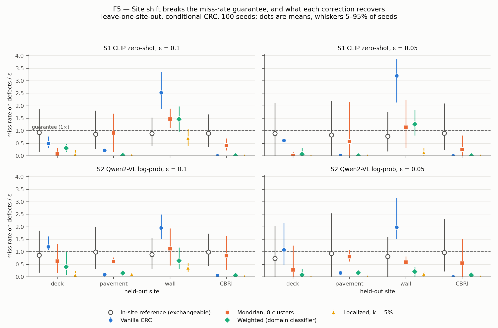
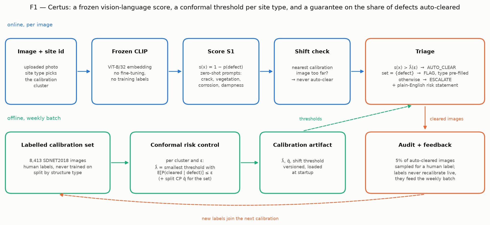

# Certus

Distribution-free guarantees for automated visual inspection: a conformal risk-control layer over frozen, off-the-shelf vision-language models that decides which building-defect images can skip human review, with a finite-sample bound on the share of real defects it misses — and a measured account of where that bound breaks.

[](https://github.com/Rishikesh10925/Certus/actions/workflows/ci.yml)
[](#12-license)

> **Status (Week 16 of 18):** all experiments, figures F1–F9, the triage service and the console are done. The paper is drafted and under review; the arXiv link will be added here when it is public. The week-by-week record is in [`docs/logbook.md`](docs/logbook.md).

---

## Headline results

All numbers are means over 100 seeds on human-labelled data; every one is regenerable from [`results/`](results/).

| Question | Answer | Source |
|---|---|---|
| Does the guarantee hold? | Yes: conformal risk control kept the missed-defect rate at or below ε in all 56 configurations, for all seven scores — including one at chance AUC. Split CP landed within ±2 points of nominal coverage in all 144 E1 configurations. | F2, F3 |
| What does it cost? | Missing at most 5% of real defects needs **83% human review** with the best off-the-shelf score (10%: 71%). Automation beats full review only while a missed defect costs less than about **9–37 reviews**. | F4, F8 |
| Does it survive a new site? | **No.** Calibrating on two SDNET2018 structure types and deploying on walls raised the miss rate to **2.0–3.2× ε in every seed**, while S1's marginal coverage moved by only 3 points. | F5 |
| Can it be repaired? | Localized CP restores validity on every held-out site (S1 walls: 0.70× ε) at 85% review; weighted CP is the best balance for S2; Mondrian CP recovers least. Every repair costs review. | F6 |
| What does marginal coverage hide? | Even without shift, 90% marginal coverage meant covering only **17–79% of defects**. | F7 |
| Whose labels? | GPT-4V bootstrap labels agree with hand-labelled gold at chance (κ = −0.007) and miss 42% of defects; calibrating on them doubles the realised joint miss rate. | logbook, Week 7 |
| Is it deployable? | A FastAPI service answers in **98 ms at p95** on a laptop GPU (606 ms CPU-only) and escalates images unlike its calibration set. On 8,416 held-out test images it missed 3.8–5.8% of defects at ε = 5%. | F9 |



## 1. Problem

Structural-defect detectors report strong aggregate accuracy, but the decision an inspection programme makes is narrower: **which images may skip a human, and how many real defects will be missed if they do?** Accuracy does not answer that, and neither does a softmax probability. Without a guarantee, organisations deploy the model and still re-check every image, so automation saves nothing.

## 2. Approach

Certus treats triage as risk control. Any model that gives an image a score is turned, using a labelled calibration set, into an auto-clear threshold λ̂ with

> E[ P(auto-cleared | defect) ] ≤ ε

under exchangeability alone (conformal risk control, Angelopoulos et al., ICLR 2024). The model is never retrained; the score only sets the price, measured as the **human-review fraction (HRF)**. The research question is what happens when the deployment site differs from the calibration site — the normal condition for inspection — and how much of the guarantee three shift corrections (Mondrian, weighted and localized conformal prediction) recover, at what cost in review.



## 3. Contributions

1. **C1 — Score comparison under risk control.** Seven off-the-shelf nonconformity scores (CLIP zero-shot, Qwen2-VL log-probability, verbalised confidence, OWLv2 objectness, MC-dropout bound, feature typicality, a learned combination) on identical splits. All keep the guarantee; their review cost differs by a factor of two (F3).
2. **C2 — The efficiency curve.** Human-review fraction against the guaranteed miss rate across two orders of magnitude of ε, with bootstrap intervals, and the cost ratio below which automation pays (F4, F8).
3. **C3 — A measured failure under site shift, and its repair.** Leave-one-site-out shows the guarantee breaking 2–3× while marginal coverage barely moves; three corrections are compared on recovered validity and review cost (F5, F6).

## 4. Methods implemented

| Method | Where | Notes |
|---|---|---|
| Split conformal prediction (LAC, APS, RAPS) | `src/certus/conformal/split_cp.py` | Corrected `⌈(n+1)(1−α)⌉` order statistic; property-tested |
| Conformal risk control | `src/certus/conformal/crc.py` | Missed-defect loss, joint and conditional guarantees |
| Learn-then-Test | `src/certus/conformal/ltt.py` | Hoeffding–Bentkus p-values, fixed-sequence testing |
| Mondrian CP / CRC | `src/certus/conformal/mondrian.py` | k-means clusters of CLIP features |
| Weighted CP / CRC | `src/certus/conformal/weighted.py` | Cross-fitted domain classifier, ESS and AUC logged |
| Localized CP / CRC | `src/certus/conformal/localized.py` | Adaptive-bandwidth CLIP kernel (no randomised correction) |
| Scores S1–S7 | `src/certus/scores/` | Frozen models only; fitted scores never see calibration data (enforced in code) |
| Triage service | `src/certus/service/`, [`service/README.md`](service/README.md) | FastAPI, per-site-type thresholds, shift check, audit sampling |
| Console | [`ui/console.py`](ui/console.py) | Streamlit, one screen, one ε slider |

## 5. Data

- **SDNET2018** (Dorafshan et al., 2018): 56,092 human-labelled images of concrete decks, pavements and walls, 15% cracked. Primary dataset; frozen stratified split, manifest hash `aeaa352b…`.
- **CBRI** building-defect dataset (Roboflow): 1,518 facade images with GPT-4V-bootstrapped labels; all 175 images outside its training split were hand-labelled as a gold set (`data/gold/gold_labels_v1.csv`). Used for the label-noise study and as an unseen target site.

Raw images are not in git. They are tracked with DVC locally, but no public DVC remote exists, so experiments that score images need the datasets downloaded from their original sources. Everything downstream of scoring — all results and all figures — works from the committed `results/` files.

## 6. Reproducing the figures

```bash
git clone https://github.com/Rishikesh10925/Certus.git
cd Certus
pip install torch==2.7.1 --index-url https://download.pytorch.org/whl/cpu   # or the cu128 index for an RTX 50-series GPU
pip install -e .
python scripts/make_figures.py          # = make figures: F1–F9 into figures/, from results/ only
```

`make figures` needs no data and no GPU. Checked in Week 16: a fresh clone in a new environment installed from `pyproject.toml` regenerated all ten images pixel-identical to the committed ones. Exact reproduction needs the pinned matplotlib (3.8.3); other versions draw the same numbers with slightly different rendering.

To re-run experiments (needs the images and, for scoring, a GPU):

```bash
make e1        # validity (F2)              make e2   # score comparison (F3)
make e3        # efficiency curve (F4, F8)   make loso # leave-one-site-out + corrections (F5–F7)
make calibrate # service calibration artifact
make latency   # service latency (F9)
```

## 7. Running the service and console

```bash
python scripts/build_service_calibration.py              # once
uvicorn certus.service.app:build --factory --port 8000
streamlit run ui/console.py
```

Endpoints: `POST /v1/inspect`, `GET /v1/calibration/{cluster}`, `POST /v1/feedback`, `GET /v1/audit/next`, `GET /v1/metrics` (Prometheus). Interactive docs at `http://localhost:8000/docs`.

## 8. Repository structure

```
certus/
├── configs/        # experiment, score and conformal settings (YAML)
├── data/           # split manifests, gold labels; raw images via DVC (not in git)
├── docs/           # blueprint, work plan, logbook, audit reports
├── figures/        # F1–F9, regenerated by `make figures`
├── results/        # every number in the paper, as JSON
├── scripts/        # experiment runners, make_figures.py, service tooling
├── service/        # how to run the FastAPI service
├── src/certus/
│   ├── conformal/  # split CP, CRC, LTT, Mondrian, weighted, localized
│   ├── data/       # loaders, sites, splits, score store
│   ├── eval/       # 100-seed protocol, coverage, efficiency, LOSO, label noise
│   ├── models/     # frozen CLIP, Qwen2-VL and OWLv2 wrappers
│   ├── scores/     # nonconformity scores S1–S7
│   ├── service/    # FastAPI app, calibration artifact, online scorer
│   ├── triage/     # triage policy and cost model
│   └── viz/        # figure functions F1–F9
├── tests/          # 220 tests, including the validity property test
└── ui/             # Streamlit console
```

## 9. Reproducibility notes

- Every result JSON records the split-manifest hash, model versions, pool size and seed count; any seed can be replayed alone.
- Experiments are run by the scripts in `scripts/` with command-line arguments; the YAML files in `configs/` document the settings but are not composed with Hydra. Weights & Biases was planned but not used.
- No Dockerfile is provided.

## 10. Limitations

All scores are off-the-shelf (best AUC 0.79), so the review costs describe these scores, not the method. Sites are SDNET2018 structure types, a proxy for new physical sites, and CBRI contributes 175 gold images. CRC bounds risk in expectation; single deployments exceeded ε in 38–57% of seeds. Localized CP is used without its randomised correction, and the service's shift check is a heuristic. The full list is in the paper and the logbook.

## 11. Citation

The arXiv preprint and citation entry will be added here once public.

## 12. License

[MIT](LICENSE)
